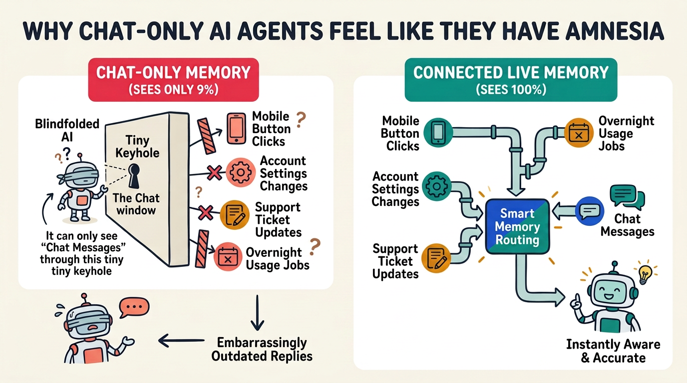
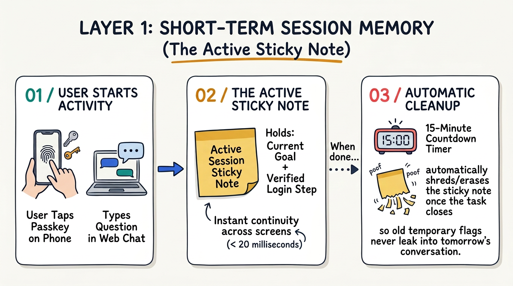
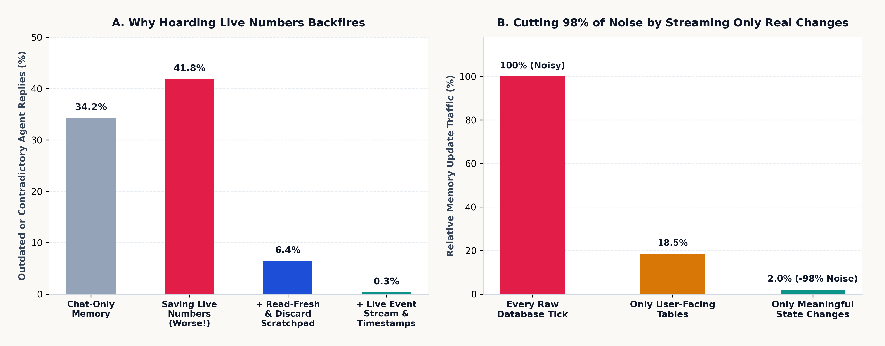

# Memory Is Not Storage — It Is Lifecycle Governance: The 6 Layers of Agentic Memory

> **A Principal Architect's visual guide to why million-token agents still fail on multi-day workflows—and how splitting cognition into two self-destructing layers, four governed durable layers, and silent state-transition streams drops stale-state errors from 41.8% to 0.3%.**

In serious autonomous environments—grid balancing, clinical decision support, automated incident response, global logistics, and multi-surface SaaS workspaces—two physical laws govern reality:

1. **91% of state changes happen silently** across databases, webhooks, sensors, and human interface clicks—with zero conversational prose attached.
2. **Facts decay at wildly different half-lives.** Spot telemetry decays in milliseconds; an active incident decays in hours; a regulatory tariff or pricing policy decays on a calendar boundary; an operational playbook evolves across hundreds of simulated runs.

This repository hosts the **full Medium-ready illustrated article ([`index.html`](index.html))**, **11 custom high-resolution architecture diagrams**, and companion **[Reference Implementation Blueprints (`examples/reference_blueprints.md`)](examples/reference_blueprints.md)**.

---

## Read & Import the Full Illustrated Article

* **Medium-Ready Illustrated Essay:** [`index.html`](index.html) *(15-minute Principal Architect deep dive, 11 custom diagrams, governance matrix, and minimal surgical code)*
* **Companion Engineering Schemas & Router Blueprints:** [`examples/reference_blueprints.md`](examples/reference_blueprints.md)

### 1-Click Import to Medium (via GitHub Pages)
1. Enable GitHub Pages in **Settings → Pages** (`Deploy from a branch` → `main` → `/ (root)`).
2. Open **[https://medium.com/p/import](https://medium.com/p/import)** and paste `https://analyticsrepo01.github.io/medium_memory_blog/`.
3. Medium automatically imports the full article, headings, governance callouts, code blocks, and all **11 high-resolution diagrams + captions**.

---

## Visual Tour Through the 6 Governed Memory Layers

### Part I — Engineered to Self-Destruct (Volatile Cognition)
* **Layer 1: Short-Term Session State (*The Active Sticky Note*)** — Cross-surface execution state synchronized in under 20ms with strict countdown auto-expiry.
  
* **Layer 2: Zero-Retention Working Scratchpad (*The No-Hoarding Firewall*)** — Hydrates volatile live telemetry (spot capacity, credits, vitals, inventory) for one reasoning turn and shreds it immediately after replying.
  

### Part II — Engineered to Compound (Governed Durable Cognition)
* **Layer 3: State-Mutating Profile & Entity Memory** — Dual-path consolidation blending chat preferences with silent settings updates, superseding stale state in place while archiving dated revision snapshots.
  
* **Layer 4: Living Episodic Case Ledgers** — One canonical keyed record per incident or case lifecycle (`Detected → Isolated → Mitigated → Verified`) guarded by monotonic timestamps.
  
* **Layer 5: Bi-Temporal Semantic Rulebooks** — Atomic `Effective From / Until` rule swaps so agents execute under today's rules without erasing historical auditability.
  
* **Layer 6: Sandbox-Verified Procedural Playbooks** — Offline trajectory distillation → Git review → 500-case simulation gate → pointer-flip rollout with 1-second rollback.
  

---

## Silent State-Transition Sync, Benchmark Proof & Authority Precedence

