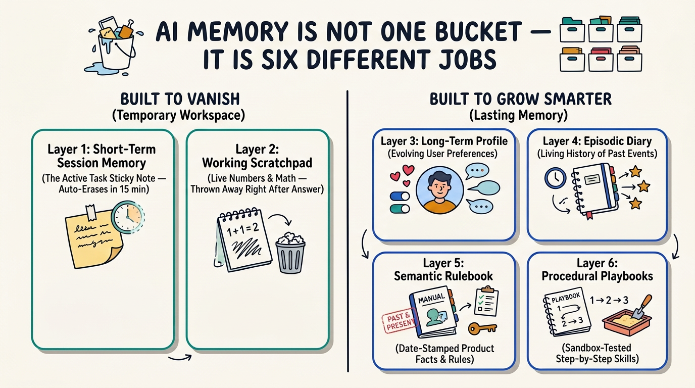
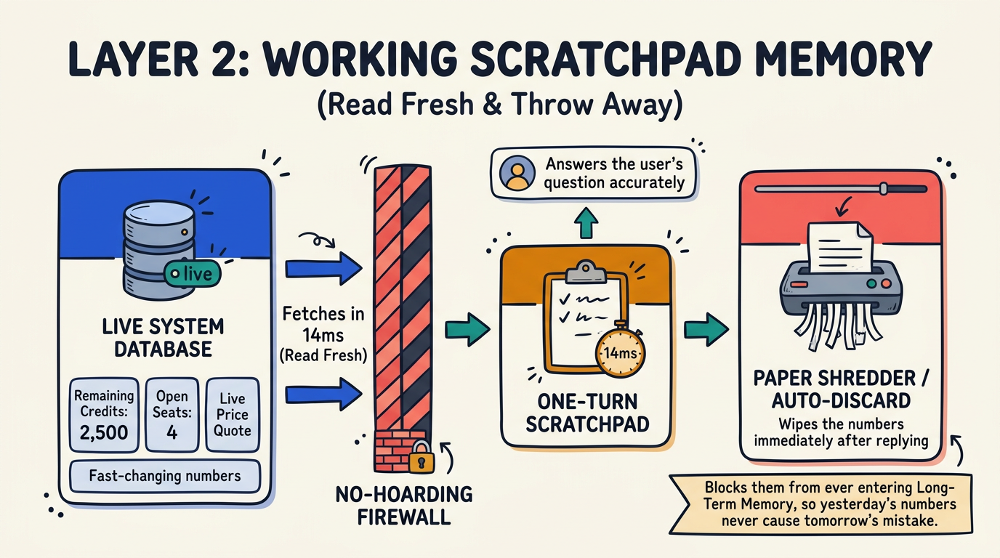
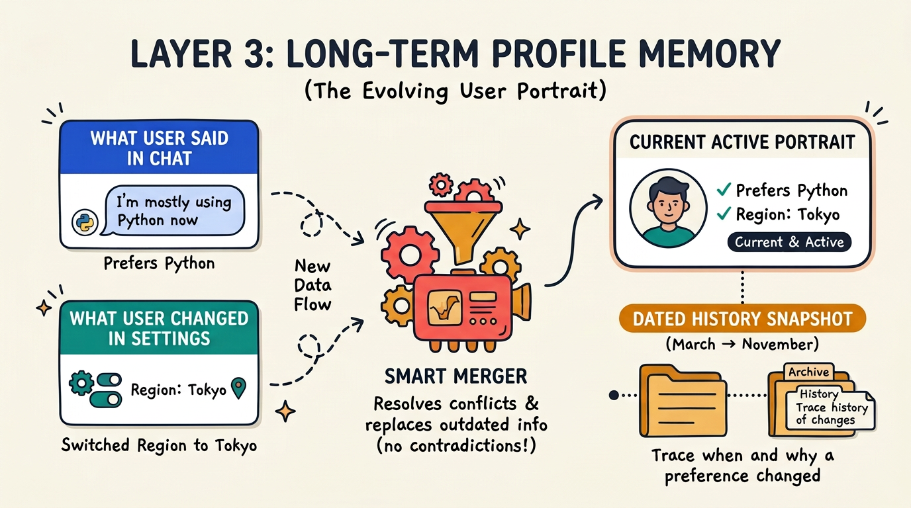
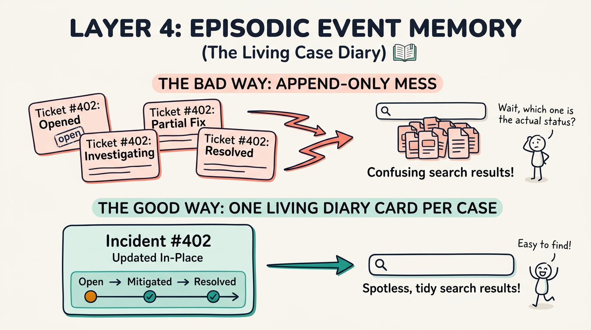
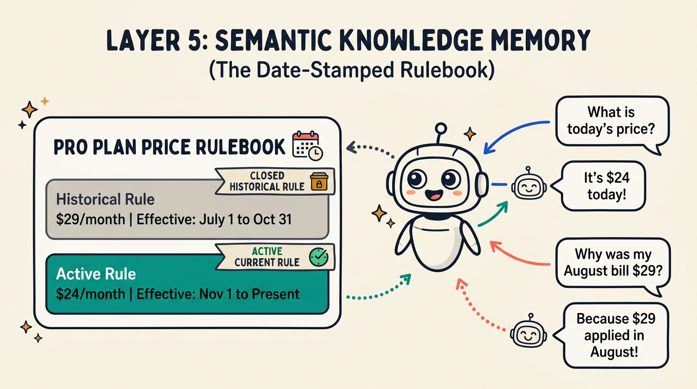
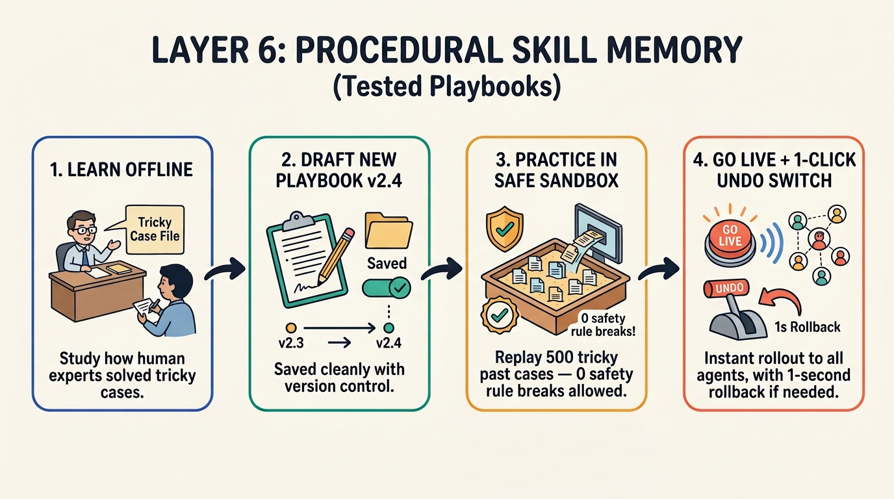
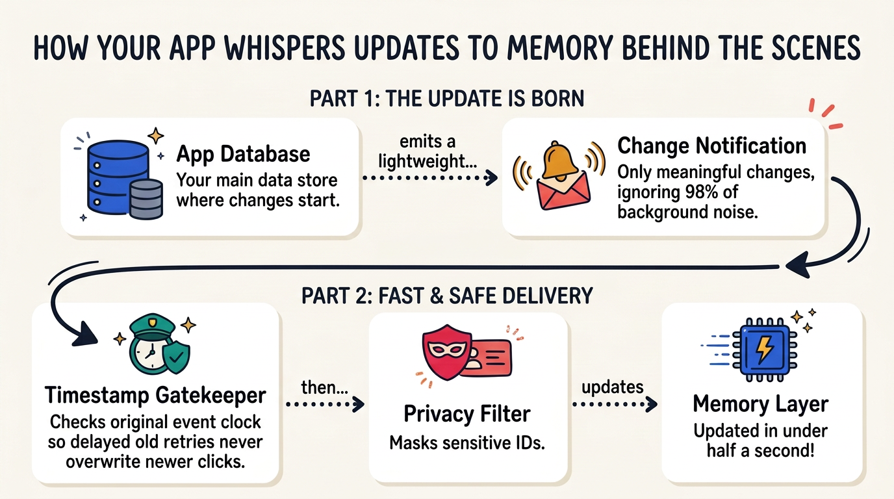
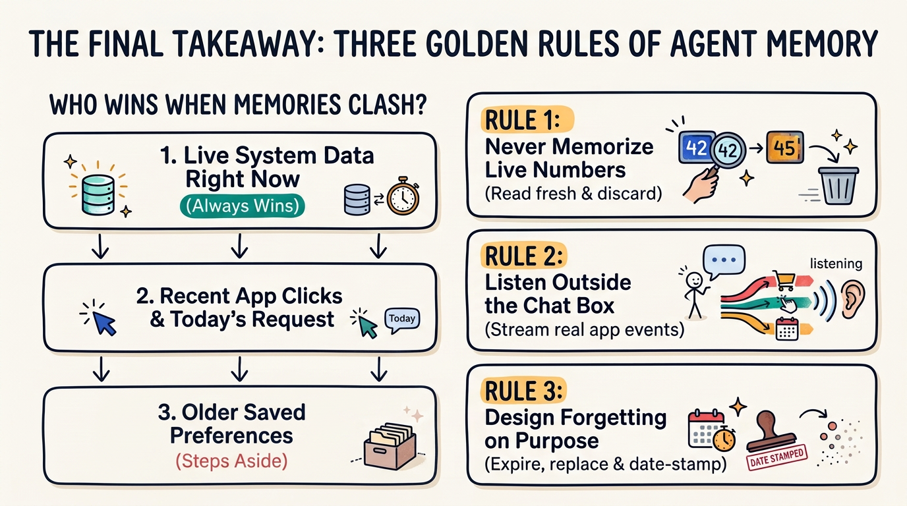

# Why Your AI Agent Feels Like It Has Amnesia: A Visual Guide to the 6 Layers of Agent Memory

> **A plain-English, illustrated tour through all six distinct layers of AI agent memory—how real apps keep each layer fresh behind the scenes, and why knowing what to forget matters more than hoarding everything.**

If an AI agent only takes notes while a user is typing inside a chat box, it misses the **91% of real life** that happens across mobile buttons, settings screens, support tickets, and background jobs—while hoarding fast-changing live numbers inside permanent memory actually makes outdated hallucinations *worse*.

This repository hosts the **visual-first Medium article ([`index.html`](index.html))**, featuring **11 custom editorial illustrations & charts**—including an individual visual deep dive for every single one of **Memory Layers 1 through 6**—written in clear, jargon-free language.


---

## Read the Full Illustrated Article

* **Standalone Medium-Style Web Article:** [`index.html`](index.html) *(10-minute visual read, minimal code)*
* **Optional Deep-Dive Engineering Schemas:** [`examples/reference_blueprints.md`](examples/reference_blueprints.md)

```bash
git clone https://github.com/analyticsrepo01/medium_memory_blog.git
cd medium_memory_blog
python3 -m http.server 8080
# Open http://localhost:8080
```

---

## Visual Tour Through All 6 Memory Layers



### Part I — Built to Vanish (Temporary Workspace)
* **Layer 1: Short-Term Session Memory (*The Active Sticky Note*)** — Tracks mid-task state across screens and auto-erases 15 minutes after the task closes.
  
* **Layer 2: Working Scratchpad Memory (*Read Fresh & Throw Away*)** — Fetches live quotas, open seats, and spot prices for a single turn and shreds them immediately after replying.
  

### Part II — Built to Grow Smarter (Lasting Memory)
* **Layer 3: Long-Term Profile Memory (*The Evolving User Portrait*)** — Blends chat conversations with settings-page changes, replacing outdated preferences cleanly while keeping dated snapshots.
  
* **Layer 4: Episodic Event Memory (*The Living Case Diary*)** — Maintains one living card per incident/case ID instead of scattering conflicting status fragments across search.
  
* **Layer 5: Semantic Knowledge Memory (*The Date-Stamped Rulebook*)** — Uses `Effective From` and `Effective Until` timestamps so the agent knows today's rules without losing historical billing context.
  
* **Layer 6: Procedural Skill Memory (*Tested Playbooks*)** — Learns from human specialists offline, practices across 500 past scenarios in a safe sandbox, and rolls out with a one-click undo switch.
  

---

## Behind-the-Scenes Sync & The Final Takeaway




