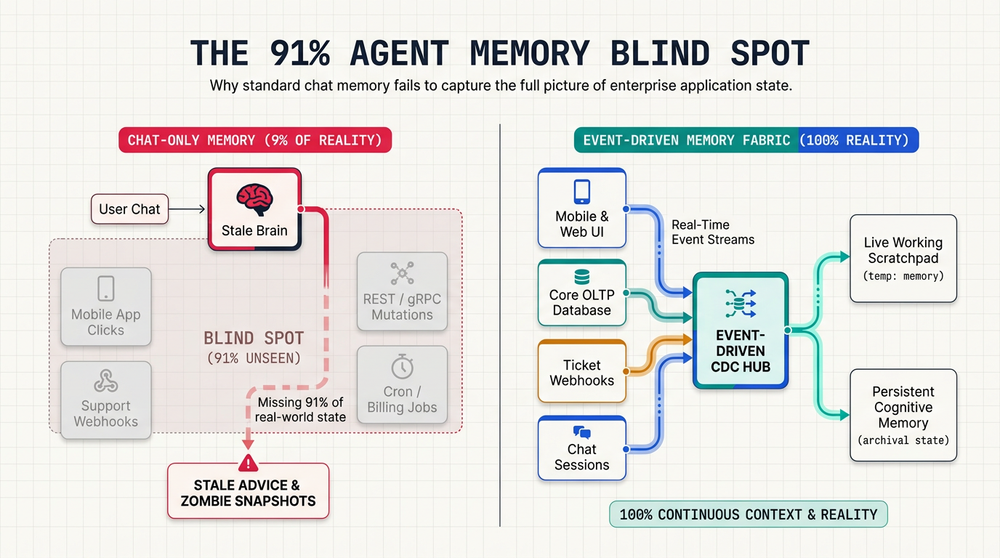
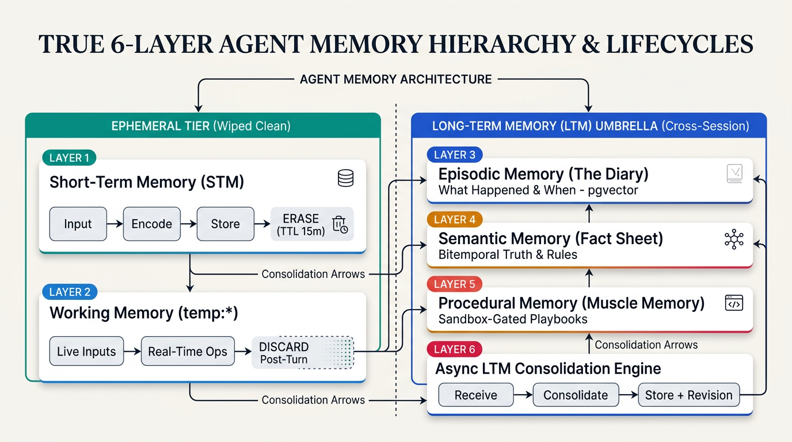
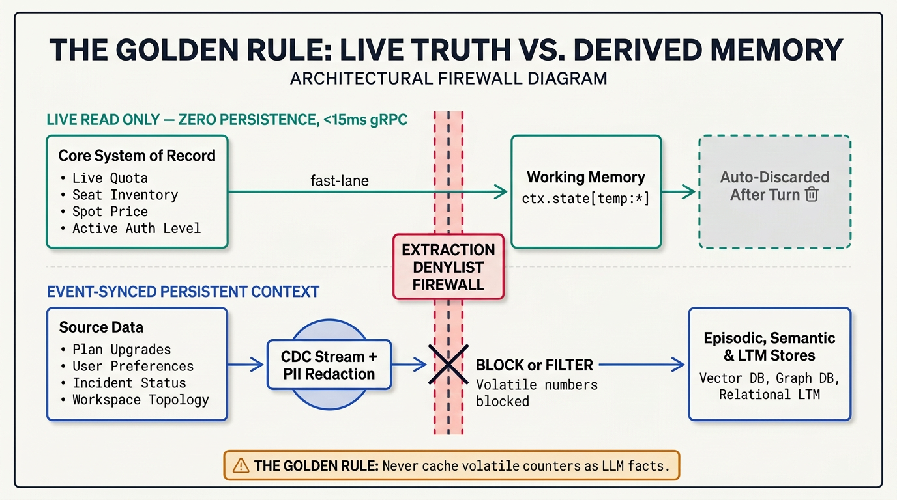
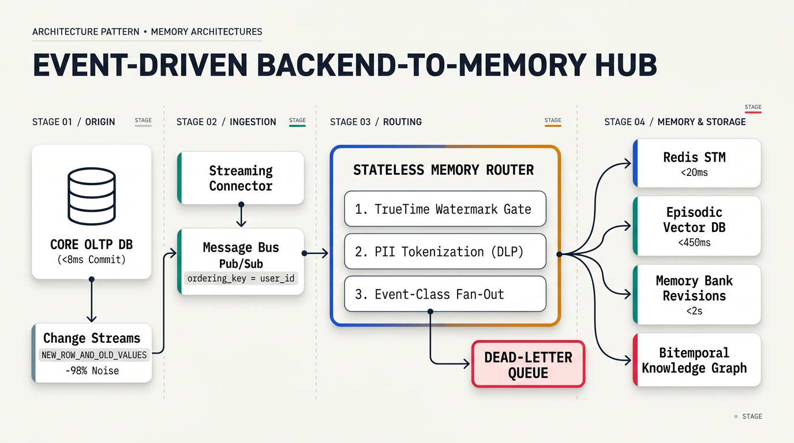
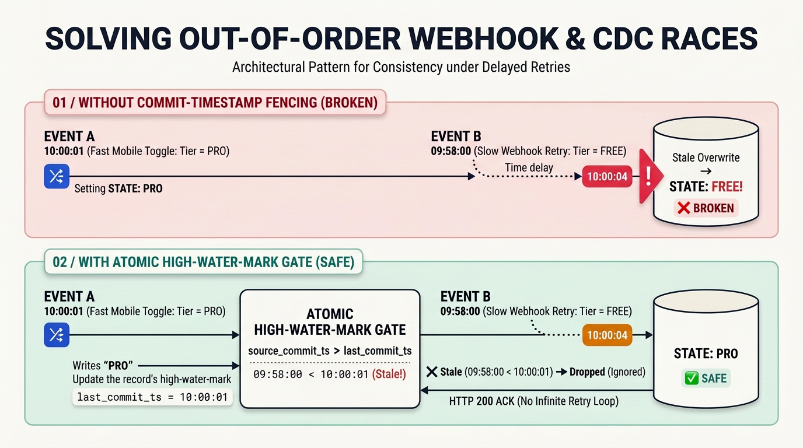
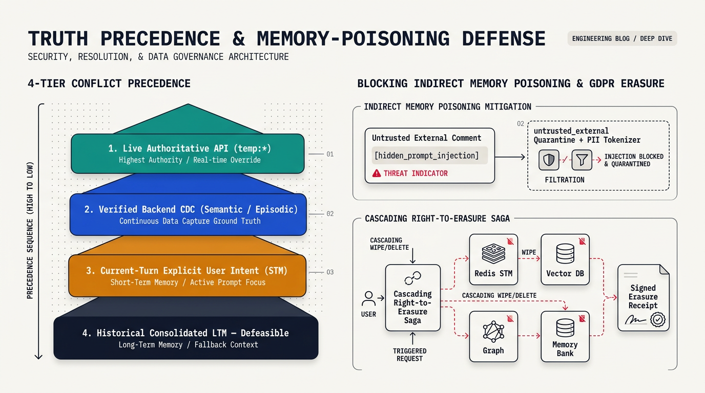
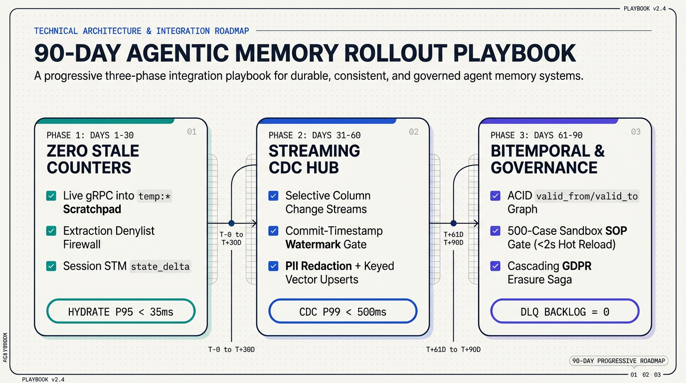

# Event-Driven Agentic Memory Architecture

> **Your AI Agent Is Blind to 91% of Reality: Engineering Event-Driven Sync Across All 6 Memory Layers**

Production AI companions fail in two opposite ways when their memory only updates inside chat windows: **Out-of-Band Blindness** (missing the 91% of user state changes that happen across mobile apps, REST/gRPC APIs, and webhooks) and **Zombie Snapshot Hallucinations** (caching volatile quotas or live counters inside Long-Term Memory).

This repository contains the **visual-first engineering deep dive ([`index.html`](index.html))**, architectural schematics, latency/SLO benchmark figures, and companion schema blueprints ([`examples/reference_blueprints.md`](examples/reference_blueprints.md)) for synchronizing backend systems across all six agent memory lifecycles.



---

## Read the Full Visual Article

* **Standalone Web / HTML Edition:** [`index.html`](index.html) *(9-minute visual-first read)*
* **Companion SQL, CDC & Agent Wiring Schemas:** [`examples/reference_blueprints.md`](examples/reference_blueprints.md)

```bash
git clone https://github.com/analyticsrepo01/medium_memory_blog.git
cd medium_memory_blog
python3 -m http.server 8080
# Open http://localhost:8080
```

---

## Architectural Highlights

### 1. True 6-Layer Memory Hierarchy & Lifecycle Contracts
Separates the **Ephemeral Tier** (*Short-Term Memory* ending in TTL **Erase** + *Working Memory* `temp:*` ending in post-turn **Discard**) from the **Long-Term Memory Umbrella** housing **Episodic**, **Semantic**, and **Procedural** stores.



### 2. The Extraction Denylist Firewall (`System of Record` vs. `System of Context`)
Live quotas, seat inventory, 30-second spot prices, and active authentication levels hydrate strictly into ephemeral `temp:*` scratchpads (`<15ms` gRPC) and auto-discard post-turn—never entering persistent LLM facts.



### 3. Event-Driven CDC Hub & Commit-Timestamp Watermark Fencing
Column-selective Change Streams (`NEW_ROW_AND_OLD_VALUES`) decouple `<8ms` OLTP commits from downstream consolidation while cutting write noise by **98%** and fencing out-of-order webhook retries via atomic database commit timestamps.





### 4. Truth Precedence, Memory-Poisoning Quarantine & 90-Day Rollout
Enforces a deterministic 4-tier conflict precedence pyramid, quarantines `untrusted_external` payloads against indirect memory poisoning, orchestrates cascading GDPR/PDPA right-to-erasure sagas, and ships incrementally in three 30-day phases.





---

## Visual Index

| Figure | File | Focus |
| :---: | :--- | :--- |
| **1** | [`assets/images/01_hero_91_percent_blindspot.png`](assets/images/01_hero_91_percent_blindspot.png) | Chat-Only Amnesia (9%) vs. Event-Driven Memory Fabric (100%) |
| **2** | [`assets/images/02_six_memory_layers_hierarchy.png`](assets/images/02_six_memory_layers_hierarchy.png) | Ephemeral Erase/Discard vs. Long-Term Memory Umbrella |
| **3** | [`assets/images/03_system_of_record_firewall.png`](assets/images/03_system_of_record_firewall.png) | Live Truth (`temp:*`) vs. Derived Persistent Context Firewall |
| **4** | [`assets/images/04_cdc_event_hub_topology.png`](assets/images/04_cdc_event_hub_topology.png) | Streaming CDC → Pub/Sub → Stateless Memory Router |
| **5** | [`assets/charts/chart_01_sync_latency_and_cdc_noise.png`](assets/charts/chart_01_sync_latency_and_cdc_noise.png) | 5 Sync Paths by P99 Latency & 98% Write-Noise Reduction |
| **6** | [`assets/images/05_truetime_watermark_fencing.png`](assets/images/05_truetime_watermark_fencing.png) | Atomic Commit-Timestamp High-Water-Mark Gate |
| **7** | [`assets/images/06_six_layer_update_mechanics.png`](assets/images/06_six_layer_update_mechanics.png) | LTM Revisions, Keyed `pgvector` Upserts, Bitemporal SQL & SOP Gate |
| **8** | [`assets/images/07_omnichannel_day_walkthrough.png`](assets/images/07_omnichannel_day_walkthrough.png) | Omnichannel Memory Sync Across 5 Daily Touchpoints |
| **9** | [`assets/images/08_security_poisoning_and_precedence.png`](assets/images/08_security_poisoning_and_precedence.png) | 4-Tier Precedence, Poisoning Quarantine & GDPR Erasure Saga |
| **10** | [`assets/charts/chart_02_contradiction_drop_and_slos.png`](assets/charts/chart_02_contradiction_drop_and_slos.png) | Contradiction Drop (`41.8% → 0.3%`) & Production SLO Ceilings |
| **11** | [`assets/images/09_ninety_day_rollout_roadmap.png`](assets/images/09_ninety_day_rollout_roadmap.png) | 90-Day Progressive Rollout Playbook (`Phase 1 → Phase 3`) |
